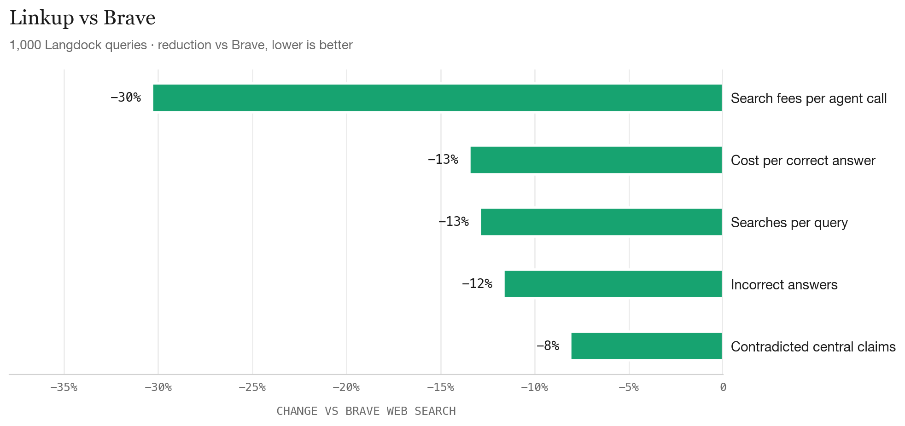
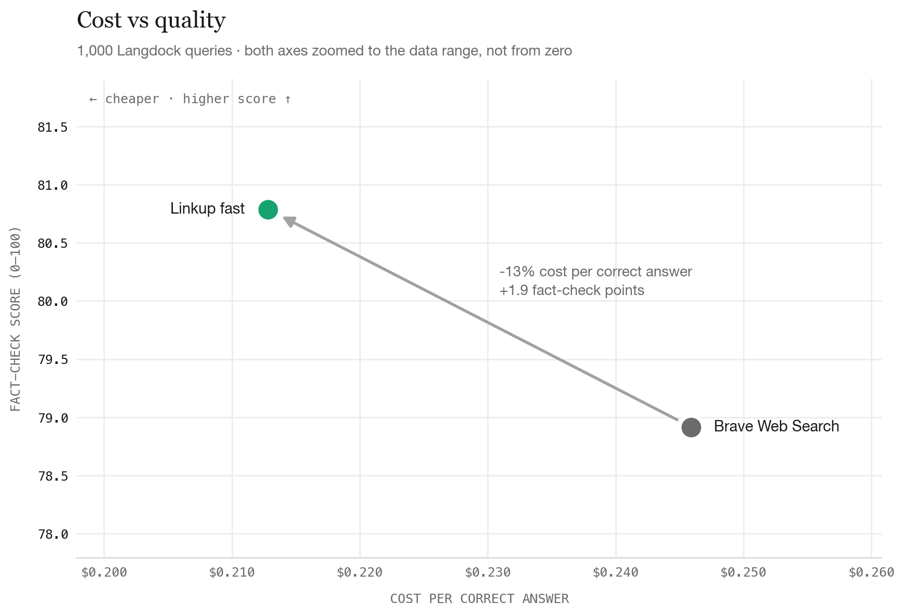
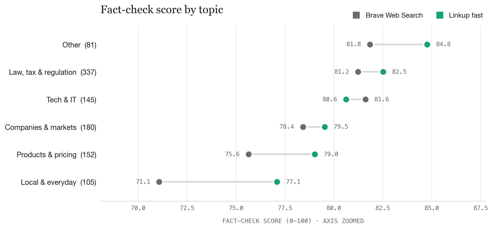

# Linkup vs Brave on Langdock's search queries

Claude Sonnet 5.5 answered all 1,000 of Langdock's search queries twice: once with Brave's Web Search API as its search tool (**Brave**) and once with Linkup as its search tool (**Linkup**). Here's what we found:

- **More accurate:** 30.8% fully correct vs 27.6%, with 12% fewer incorrect answers (227 vs 257).
- **13% cheaper** per correct answer.
- **30% lower search fees** per agent call ($0.0079 vs $0.0113).

## Setup

|  | Brave Web Search | Linkup fast |
|---|---|---|
| Model | `claude-sonnet-5-5` | `claude-sonnet-5-5` |
| Endpoint | `/res/v1/web/search` | `/v1/search`, `depth=fast` |
| Settings | `count=10`, `extra_snippets=true` | `searchResults`, `maxResults=10` |
| What Claude sees per result | title, URL, date, description, up to 5 extra snippets | title, URL, content |
| Search cap | 10 per query | 10 per query |

Claude decides what to search for and how often. Each tool description asks for the query style its provider is built for: keyword queries for Brave, natural-language retrieval instructions for Linkup. Neither provider gets a location hint: Brave runs without `country` or `search_lang`, and Linkup has no location setting.

**Queries:** all 1,000 synthetic search queries Langdock shared on October 16, 2026 as typical of what its product sends to a search API. Each query is sent to Claude as the user's message, with a system prompt for an enterprise assistant used by companies in Germany and across Europe. 588 are in German, 360 in English and 52 in other languages. `gpt-6-luna` tagged each query with a topic.

**Grading:** the queries have no answer key, so a `gpt-6-luna` judge fact-checks each answer instead.
The judge sees one answer at a time and checks up to 5 of its most important claims with its own web search (OpenAI's, independent of both arms), marking each supported, contradicted or unverifiable. It gives a verdict (correct / partial / incorrect / not found) and a score out of 100: answers the query 30, accuracy 50 (minus 25 for each contradicted central claim and 10 for each other contradicted claim), freshness 10, calibration 10.

## Fact-check

| Metric | Brave Web Search | Linkup fast |
|---|---|---|
| Correct or partially correct | 739 | **770** |
| Differs from sources | 257 | **227** |
| Not found | 4 | **3** |
| Score (0–100, average) | 78.9 (77.6–80.2) | **80.8 (79.6–82.0)** |
|   Answers the query (of 30) | 24.4 | **25.5** |
|   Accuracy (of 50) | 38.1 | **38.8** |
|   Freshness (of 10) | 8.7 | 8.7 |
|   Calibration (of 10) | 7.8 | **7.9** |
| Claims contradicted by the judge's sources | 804 of 4569 (17.6%) | **772 of 4549 (17.0%)** |
| Answers with at least one contradicted claim | 590 | **588** |

## Cost

| Metric | Brave Web Search | Linkup fast |
|---|---|---|
| Cost per correct answer | $0.2459 | **$0.2128** |
| Search fees per query | $0.0113 | **$0.0079** |
| Model tokens per query | **$0.0565** | $0.0576 |
| Searches per query | 2.27 | **1.98** |
| Input tokens per query (incl. cache) | 19,243 | **18,565** |
| Output tokens per query | **1,758** | 1,824 |

Linkup cost reflects the snippet compressor (30% fewer retrieved tokens), being incorporated into a custom stack for Langdock.

## Topics and languages

| Topic | Queries | Brave Web Search: fact-check score | Linkup fast: fact-check score |
|---|---|---|---|
| Law, tax & regulation | 337 | 81.2 | **82.5** |
| Companies & markets | 180 | 78.4 | **79.5** |
| Tech & IT | 145 | **81.6** | 80.6 |
| Products & pricing | 152 | 75.6 | **79.0** |
| Local & everyday | 105 | 71.1 | **77.1** |
| Other | 81 | 81.8 | **84.8** |
| German | 588 | 78.5 | **79.9** |
| English | 360 | 79.4 | **82.8** |
| Other languages | 52 | **79.8** | 77.5 |

## Files

- `data/`: the 1000 queries with topic and language, each arm's answers (with the searches Claude ran, tokens and retrieved URLs), and every grade with the judge's reasoning
- `charts/`: the charts above
- `build.py`: rebuilds `charts/` and this README from `data/` (`python3 build.py`)
